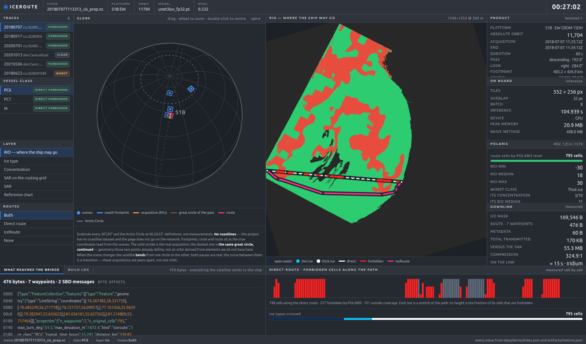
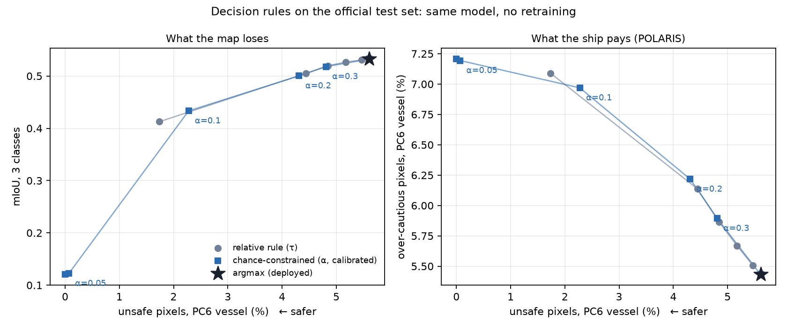
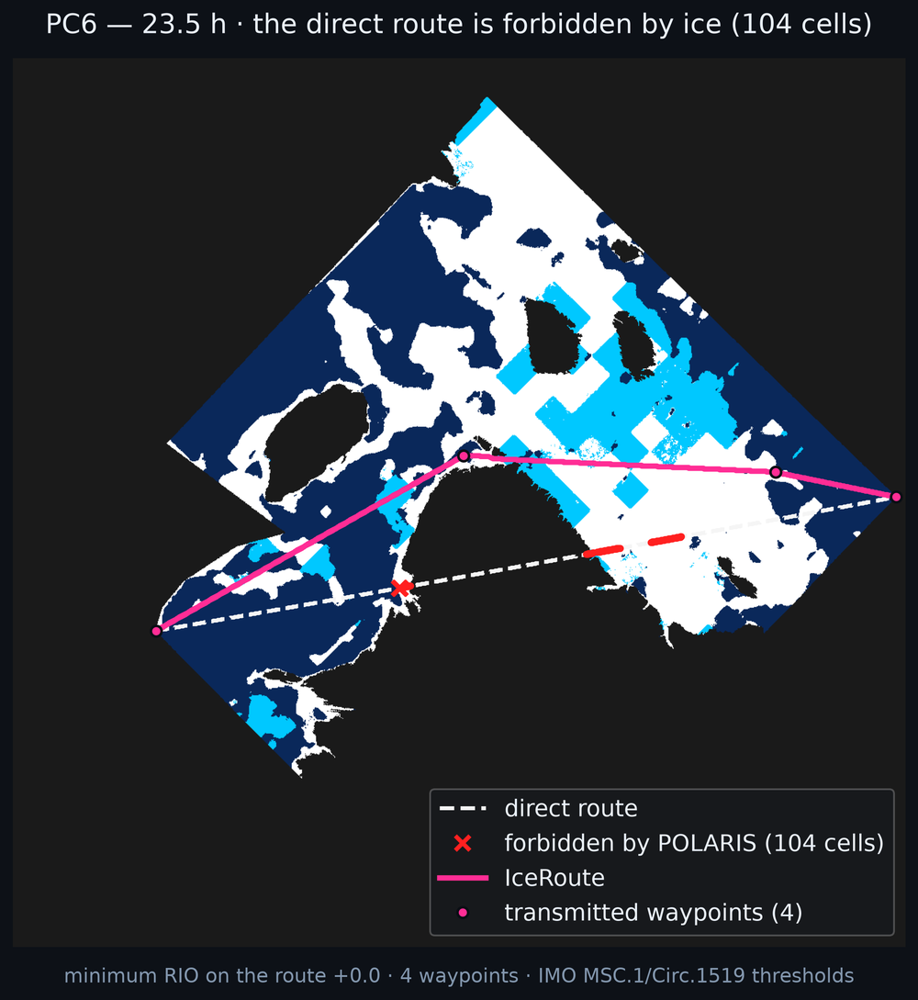
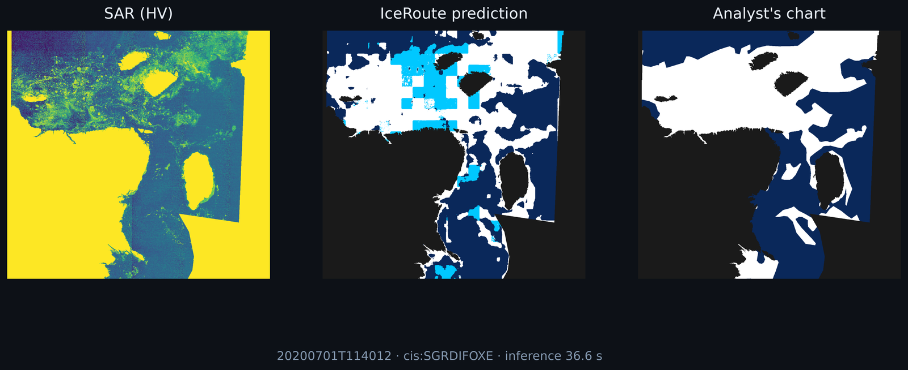

<div align="center">

# IceRoute

**On-board sea-ice segmentation and POLARIS-constrained Arctic routing, sized for a CubeSat.**

A 2 MB INT8 U-Net reads a Sentinel-1 radar scene, maps the ice, computes the fastest route a
given ship is allowed to take under the IMO POLARIS rules, and sends down **the verdict** instead
of the image: 148 KB instead of 55 MB, of which the route is 431 bytes.

[](https://github.com/DoubleF35/IceRoute/actions/workflows/ci.yml)
[](LICENSE)


🏆 **First prize — ESA EO MakerSpace Hackathon** (Frascati, June 2026)

[**Live demo**](https://federicofassio.it/IceRoute/) ·
[Architecture](docs/architecture.md) ·
[Model card](docs/model-card.md) ·
[Decision log (43 entries)](docs/decisions.md) ·
[Italiano](README.it.md)



</div>

---

## The problem

Ships in ice navigate on ice charts and satellite products that reach the bridge hours after the
satellite saw the ice; the fastest operational service today delivers *up to one hour after
acquisition* (IcySea, Copernicus Marine), and it still depends on ground processing. Meanwhile
Arctic traffic keeps growing (PAME: +37 % ships, +111 % distance sailed, 2013–2023) and since
1 January 2026 IMO resolution **MSC.538(107)** extends Polar Code requirements, including the
capability to receive up-to-date ice information, to many more vessels.

A SAR scene is ~55 MB. The decision a captain needs is a few hundred bytes. IceRoute asks what it
takes to compute that decision **in orbit**, with a model small enough for an on-board
accelerator, and measures every step of the answer.

## What it does

```
Sentinel-1 SAR (HH, HV, incidence angle)
   └─► tiled U-Net, 1.96 M params, INT8 ONNX ........ 3-class ice map
         └─► geocode to EPSG:3413, 500 m grid ....... + chart concentration
               └─► POLARIS Risk Index Outcome per cell and ship class (IMO MSC.1/Circ.1519)
                     └─► RIO → safe speed → time cost
                           └─► A* (16-connected) + string pulling ...... route GeoJSON
                                 └─► downlink: PNG mask + route ≈ 148 KB
```

Every stage is a module with tests; see [docs/architecture.md](docs/architecture.md).

## Results

All numbers are measured by code in this repository and stored in
[`artifacts/metrics.json`](artifacts/metrics.json). Test numbers come from the **20 scenes of the
official AI4Arctic test set**, never used for training, model selection or demo-scene choice.

| | |
|---|---|
| **Segmentation** (3 classes, official test set) | mIoU **0.532** · ice/water accuracy **0.906** |
| **Same operational decision as the ice chart** (POLARIS, PC6) | **89.0 %** of pixels |
| **Model size** | 7.53 MB FP32 → **2.05 MB INT8**, no measurable accuracy loss |
| **Latency** (256² tile, 1 CPU thread) | 93 ms FP32 → **40 ms INT8** · whole scene ~2.6 s on GPU |
| **Downlink compression** | **439 : 1** median vs. the PNG-compressed SAR scene (281–770) |
| **Downlink packet** | **148 KB** median (mask + route) · route alone **431 bytes** |
| **Unsafe pixels** (model more permissive than the chart, PC6) | **5.6 %** overall · 0.8 % median scene · **41 %** worst scene |
| **Calibration** (top-class ECE, test) | **16.4 % → 3.9 %** with one temperature fitted on validation |
| **Risk-aware rule** (α = 0.1, no retraining) | unsafe pixels **5.6 % → 2.3 %** for +1.5 pt over-caution, at the cost of 0.10 mIoU |

The worst case is published on purpose: the demo ships a dedicated worst-case scene, and the
[model card](docs/model-card.md) lists what the model gets wrong and why.



<sub>Same model, different decision rules. Lowering α trades map accuracy (left) for fewer unsafe
pixels; the cost in POLARIS terms (right) is far smaller than the cost to the map. The deployed
system keeps argmax ([D-043](docs/decisions.md#d-043)).</sub>

<table>
<tr>
<td width="50%"></td>
<td width="50%"></td>
</tr>
<tr>
<td><sub>The direct route crosses ice POLARIS forbids for a PC6 vessel; IceRoute's route goes around it. Only the 4 waypoints are transmitted.</sub></td>
<td><sub>SAR input, predicted three-class map, and the analysts' ice chart for the same scene.</sub></td>
</tr>
</table>

## Engineering highlights

* **Honest evaluation.** Split by scene, not by patch; the official test set is touched once.
  Errors are also measured in POLARIS units, by direction: an *unsafe* error (the model says the
  ice is easier than it is) is reported separately from an over-cautious one.
* **Early estimates audited against measurements.** The design-phase numbers (58 KB model,
  < 4 KB packet, 200:1 compression) were re-measured and corrected in public:
  2.05 MB, 148 KB, 439:1 — see [*Early estimates vs. measurements*](docs/decisions.md#early-estimates-vs-measurements).
* **Calibrated risk.** Temperature scaling fitted on validation scenes, ECE and reliability
  measured on test ([`calibration.py`](src/iceroute/model/calibration.py)). Calibrated
  probabilities make a *chance-constrained* routing rule meaningful: "plan as if the ice were
  thick wherever there is at least an α chance it is" ([`risk.py`](src/iceroute/model/risk.py)).
  The whole safety/accuracy curve is published rather than one tuned point
  ([D-043](docs/decisions.md#d-043)).
* **Streaming inference.** Whole-scene tiled inference with a 20 MB accumulator instead of
  400 MB ([D-013](docs/decisions.md#d-013)) — the difference between fitting on board or not.
* **Faithful deployment.** ONNX export checked for parity (max |Δlogit| 4 × 10⁻⁵, zero argmax
  flips); INT8 static per-channel quantization measured on held-out scenes.
* **Correct geodesy.** Planar distances in EPSG:3413 are divided by the map scale factor (up to
  2.8 % error otherwise, [D-010](docs/decisions.md#d-010)); "blocked by ice" and "outside
  coverage" are distinguished ([D-011](docs/decisions.md#d-011)).
* **One implementation per stage.** The demo's live path and the precomputation call the same
  function; the CLI only dispatches. 600+ tests, CI on every push.

## Quick start

Requires Linux or macOS, [uv](https://docs.astral.sh/uv/), and ~1 GB of disk for the demo.

```bash
git clone https://github.com/DoubleF35/IceRoute && cd IceRoute
make setup        # Python 3.11 venv + exact pinned dependencies
make fetch-demo   # demo bundle + trained weights from the GitHub Release
make demo         # Streamlit UI      (or: make console → console.html, no server)
```

Run the full pipeline on a scene of your own:

```bash
iceroute run path/to/<scene>_prep.nc --out out/
```

Reproduce the model from scratch (NVIDIA GPU with ≥ 6 GB, ~60 GB disk):

```bash
make download     # stratified AI4Arctic subset (resumable)
make data train eval quantize calibrate risk
make precompute report
```

`make` alone lists every target; `iceroute --help` lists every stage.

## Repository layout

| Path | Contents |
|---|---|
| `src/iceroute/data/` | AI4Arctic download, scene loading, balanced patch extraction, class collapse |
| `src/iceroute/model/` | U-Net, losses, training, evaluation, ONNX export, INT8, calibration, risk rules |
| `src/iceroute/routing/` | geocoding, POLARIS, cost grid, A*, baselines, path smoothing |
| `src/iceroute/report/` | downlink compression, consolidated metrics, figures, status page |
| `src/iceroute/demo/`, `src/iceroute/web/` | Streamlit UI, offline single-file demo, globe console |
| `configs/` | every parameter; assumptions are tagged `PROVISIONAL` |
| `docs/` | [architecture](docs/architecture.md), [model card](docs/model-card.md), [decision log](docs/decisions.md) |
| `tests/` | unit and integration tests (`make test-fast` runs the CI subset) |

## Data and licences

* **AI4Arctic Sea Ice Challenge Dataset** — DTU Space and ESA Φ-lab,
  DOI [10.11583/DTU.c.6244065](https://doi.org/10.11583/DTU.c.6244065). Contains modified
  Copernicus Sentinel-1 data. Not redistributed here; `make download` fetches it.
* **POLARIS** risk index values are transcribed from IMO MSC.1/Circ.1519 into
  [`data/polaris_rv.csv`](data/polaris_rv.csv), with the source table for each row.
* Code: [MIT](LICENSE).

## About

IceRoute started as Team **Space Eagle**'s concept at the ESA EO MakerSpace Hackathon, where it
won first prize. The software in this repository — data pipeline, model, quantization, calibration,
routing, evaluation and demos — was designed and written by **Federico Fassio** between September
and November 2026.

This is a research prototype. It is not validated against vessel tracks and must not be used for
navigation.

If you use it, please cite it via [`CITATION.cff`](CITATION.cff).
