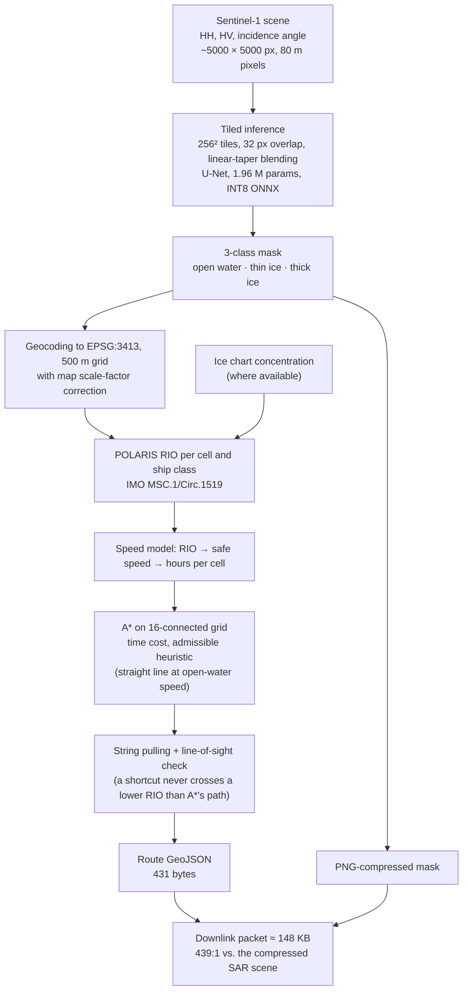

# Architecture

IceRoute moves the interpretation of a SAR scene from the ground segment to the satellite. The
satellite does not downlink 55 MB of radar echo for someone to interpret hours later; it downlinks
the verdict: a three-class ice map and the route that follows from it, about 148 KB, of which the
route itself is 431 bytes.

## Data flow

## Stages and where they live

| Stage | Module | Key decisions |
|---|---|---|
| Dataset download (Figshare, resumable, MD5-checked) | `iceroute.data.figshare`, `scripts/download_subset.py` | D-006 |
| Scene loading, invalid-pixel masks, `flip` handling | `iceroute.data.loader` | D-009 |
| Balanced patch extraction, edge-weighted sampler | `iceroute.data.patches` | D-017 |
| Six → three class collapse | `iceroute.data.collapse` | D-020 |
| U-Net, losses (CE + Dice + Lovász), training loop | `iceroute.model.unet`, `.losses`, `.train` | D-005, D-025 |
| Streaming whole-scene inference | `iceroute.model.inference` | D-013 |
| Evaluation on the official test set, HV-threshold baselines | `iceroute.model.evaluate` | D-015, D-018 |
| Errors measured in RIO units, not only labels | `iceroute.model.rio_error` | — |
| Safety-biased decision rule (τ sweep) | `iceroute.model.safety_bias` | D-025 |
| ONNX export with parity check, INT8 quantization | `iceroute.model.export`, `.quantize` | D-014, D-019 |
| Temperature scaling, ECE, reliability diagram | `iceroute.model.calibration` | D-042 |
| Chance-constrained decision rule, safety/accuracy curves | `iceroute.model.risk` | D-043 |
| Geocoding with scale-factor correction | `iceroute.routing.geocode` | D-010 |
| POLARIS RIO, most-cautious SOD mapping | `iceroute.routing.polaris`, `data/polaris_rv.csv` | D-007, D-008 |
| Cost grid, land mask, speed model | `iceroute.routing.cost` | D-026 |
| A*, geodesic baseline, coverage-aware feasibility | `iceroute.routing.astar`, `.baseline` | D-011 |
| String pulling, simplification | `iceroute.routing.shortcut`, `.simplify` | D-040 |
| Downlink payload and compression ratio | `iceroute.report.compression` | D-016, D-028, D-034 |
| Consolidated metrics, early-estimate audit | `iceroute.report.metrics` | D-033, D-035 |
| Demo bundle precomputation, Streamlit UI | `iceroute.demo` | D-022, D-029, D-030 |
| Offline single-file demo and globe console | `iceroute.web` | D-032, D-038, D-039 |

## Design rules

* **Configuration, not constants.** Every parameter lives in `configs/*.yaml`; values that are
  assumptions rather than measurements are tagged `PROVISIONAL` and surfaced in the UI.
* **One implementation per stage.** The live "run it now" path in the demo calls the same
  `process_scene` as the precomputation (D-029); the CLI dispatches to the stage modules and
  implements nothing itself.
* **Measured, then shown.** The demo and the report read numbers from `artifacts/metrics.json`;
  nothing on screen is typed by hand. `make report` regenerates all of it.
* **Split by scene, never by patch.** Validation numbers from a patch-level split are inflated by
  near-duplicate neighbours and collapse on new scenes.
* **Offline first.** `demo.html` and `console.html` are single self-contained files: no Python, no
  server, no network.
