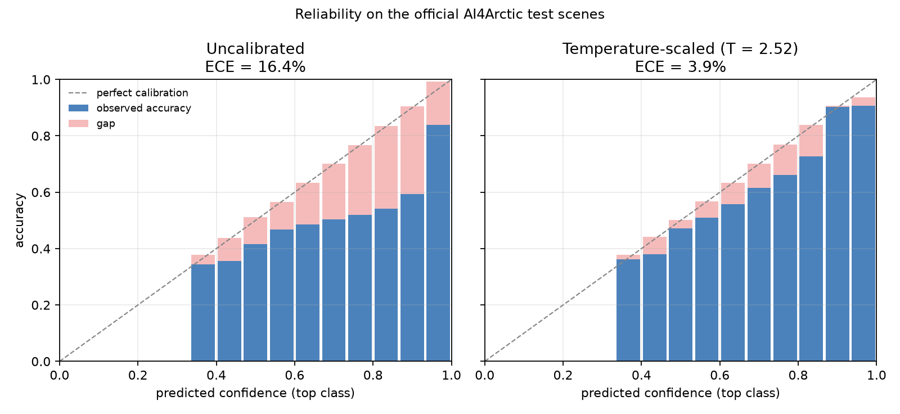
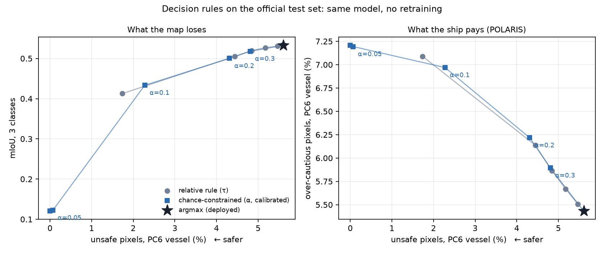

# Model card — IceRoute U-Net (`unet3lov`)

| | |
|---|---|
| **Task** | Semantic segmentation of sea-ice stage of development from Sentinel-1 SAR |
| **Architecture** | U-Net, encoder `[16, 32, 64, 128]`, bottleneck 256, GroupNorm (8 groups) |
| **Parameters** | 1,964,131 (budget: < 2,000,000 — [D-005](decisions.md#d-005)) |
| **Input** | 3 channels, 256 × 256 tiles: HH, HV (σ⁰, standard-scaled), incidence angle |
| **Output** | 3 classes: *Open water*, *Thin ice*, *Thick ice* ([D-020](decisions.md#d-020)) |
| **Loss** | Cross-entropy (inverse-frequency weights, clipped at 10) + 0.5 Dice + 1.0 Lovász-softmax |
| **Training** | AdamW 3e-4, cosine with 500 warm-up steps, batch 16, AMP fp16, seed 1337, best epoch 19 |
| **Formats** | PyTorch FP32 (7.5 MB), ONNX FP32 (7.5 MB, opset 17), ONNX INT8 (2.05 MB) |
| **Config** | [`configs/train3_lovasz.yaml`](../configs/train3_lovasz.yaml) |
| **Weights** | GitHub Release `v1.0.0` — `make fetch-demo` |

## Data

[AI4Arctic Sea Ice Challenge Dataset](https://doi.org/10.11583/DTU.c.6244065) (DTU Space,
ESA Φ-lab), *ready-to-train* version. Labels are operational ice charts drawn by analysts of
the Danish (DMI) and Canadian (CIS) ice services, following the WMO egg code.

* **Train / validation:** a stratified subset of 55 scenes, split **by scene** (45 / 10) and
  frozen in [`configs/split.yaml`](../configs/split.yaml). Patches from one scene never appear
  on both sides — a patch-level split inflates validation scores that then collapse on new
  scenes.
* **Test:** the 20 scenes of the **official AI4Arctic test set**, never used for training,
  model selection, threshold choice or demo-scene ranking.
* The six SOD classes were collapsed to three after the six-class model failed its target
  ([D-020](decisions.md#d-020)); no AI4Arctic label contains a *ridged / deformed ice* class,
  so the model does not and cannot predict one ([A-05](decisions.md#early-estimates-vs-measurements)).

## Results — official test set (20 scenes)

| Metric | Value |
|---|---|
| mIoU (3 classes) | **0.532** |
| IoU — Open water / Thin ice / Thick ice | 0.846 / **0.136** / 0.615 |
| Pixel accuracy | 0.813 |
| Ice vs. water: accuracy / IoU | 0.906 / 0.805 |
| Validation mIoU (frozen split, for reference only) | 0.638 |
| Per-scene mIoU, min – median – max | 0.30 – 0.60 – 0.93 |

The validation-to-test drop (0.638 → 0.532) is the honest generalisation gap to new scenes,
regions and seasons; the test number is the one quoted everywhere.

### What matters for navigation: errors in POLARIS terms

A pixel label is not what a ship acts on; the POLARIS Risk Index Outcome (RIO) is. The model is
therefore also scored by computing RIO from its mask and from the analyst's chart, per ship
class ([`src/iceroute/model/rio_error.py`](../src/iceroute/model/rio_error.py)):

| Ship class | Same operational decision as the chart | **Unsafe** (model permits, chart forbids or restricts) | Over-cautious |
|---|---|---|---|
| PC6 | 89.0 % | 5.6 % (median scene 0.8 %, worst scene **41.1 %**) | 5.4 % |
| PC7 | 89.0 % | 5.6 % (median 0.8 %, worst 41.1 %) | 5.4 % |
| IA  | 88.2 % | 6.4 % (median 0.9 %, worst 41.3 %) | 5.4 % |

Pixel-weighted over the 20 test scenes. The worst case is published, not hidden: the demo ships a
dedicated *worst-case* scene ([D-024](decisions.md#d-024)).

## On-board footprint

| | FP32 | INT8 |
|---|---|---|
| Model size | 7.53 MB | **2.05 MB** (1.09 bytes / parameter) |
| Latency per 256² tile, 1 CPU thread | 93.1 ms | **39.7 ms** |
| Latency per 256² tile, all threads | 30.0 ms | 29.5 ms |
| Peak RSS of the inference process | 1.0 GB | 0.98 GB |
| Quality vs. FP32 (2 test scenes) | — | −0.46 pt ice/water agreement, no measurable mIoU loss ([D-019](decisions.md#d-019)) |

INT8: static, per-channel, min-max calibration on 200 patches (ONNX Runtime). ONNX FP32 export
parity with PyTorch: max |Δlogit| = 4.4 × 10⁻⁵, zero argmax disagreements on 262,144 pixels.
CPU latencies are measured on a laptop (x86-64, 22 cores); they are **not** a measurement of any
flight accelerator.

## Calibration

Temperature scaling, fitted on the 10 validation scenes and measured on the 20 test scenes
([D-042](decisions.md#d-042), [`artifacts/calibration.json`](../artifacts/calibration.json)):

| | Uncalibrated | T = 2.52 |
|---|---|---|
| Top-class ECE | 16.4 % | **3.9 %** |
| NLL / Brier | 0.963 / 0.361 | **0.554 / 0.308** |
| Class-wise ECE, *Thick ice* | 15.5 % | **7.0 %** |

Calibration leaves every label, and therefore mIoU and every route, unchanged. The model's errors
stay confident ([D-018](decisions.md#d-018)): on wrong pixels it still puts 0.75 on the wrong
class after scaling. Temperature fixes the average over-confidence, not individual errors.

## Decision rule and safety

The deployed system labels each pixel by argmax. A *chance-constrained* rule (most dangerous class
with calibrated probability ≥ α) was measured on the same 20 test scenes
([D-043](decisions.md#d-043), [`artifacts/risk_curve.json`](../artifacts/risk_curve.json)), PC6:

| Rule | mIoU | Unsafe | Over-cautious |
|---|---|---|---|
| argmax (deployed) | 0.532 | 5.61 % | 5.43 % |
| α = 0.2 | 0.500 | 4.31 % | 6.22 % |
| α = 0.1 | 0.433 | **2.28 %** | 6.97 % |
| α = 0.05 | 0.122 | 0.07 % | 7.19 % |

Below α = 0.1 the map collapses to "thick ice almost everywhere". The over-cautious cost is measured
with the chart's concentration on both sides, so it understates what a chart-free deployment would
pay. Effects on routes (transit time, detours) are not yet measured.

## Known limitations

* **Thin ice is weak** (IoU 0.136): it is the rarest class (8 % of test pixels) and is mostly
  confused with thick ice. In routing terms this error is *conservative* for most ship classes,
  but it is still the main accuracy gap.
* **Scene-to-scene variance:** per-scene mIoU ranges from 0.30 to 0.93. The six worst scenes
  span four seasons (June, October, February, April, December, January) and both ice services,
  so no single factor such as melt season or one region explains them in this 20-scene sample.
* **Concentration is not predicted.** POLARIS needs ice concentration; IceRoute takes it from the
  ice chart where available and only *zeroes* it where the model sees open water.
* **Label noise:** ice charts are polygon-level analyst products, not pixel-level truth; part of
  the measured error is disagreement with a coarse label.
* **Not for navigation.** This is a research prototype. It has not been validated against vessel
  tracks or certified for any operational use.

## Intended use

Research on on-board (edge) processing of SAR for maritime situational awareness: measuring what a
sub-2M-parameter model can deliver, what it costs in bytes and milliseconds, and how its errors
propagate into a regulatory risk index and a route.
